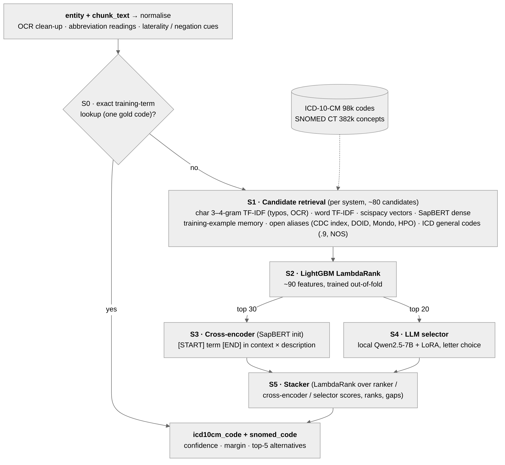

# TermMap: clinical term → ICD-10-CM + SNOMED CT

TermMap maps an extracted clinical entity, together with its chunk context, to one ICD-10-CM code and one SNOMED CT concept. Every answer it gives is a code from the supplied dictionaries. It was built for the HiLabs TermMap challenge (problem statement: `TermMap A Clinical Term Mapping Engine…md`).

- **Write-up (PDF):** [`docs/TermMap_writeup.pdf`](docs/TermMap_writeup.pdf), built from [`docs/writeup.md`](docs/writeup.md) by `bash scripts/make_report.sh`
- **Demo video:** DEMO_VIDEO_LINK
- **Experiment log:** [`docs/experiments.md`](docs/experiments.md) · data findings: [`docs/analysis.md`](docs/analysis.md)

## Architecture



| Stage | What it does | Model / resource |
|---|---|---|
| Normalise | OCR clean-up, abbreviation readings (ambiguous ones give several), laterality / negation / history cues | rules + abbreviation table |
| S0 lookup | a normalised training term with a single gold code returns that code | training file |
| S1 retrieval | ~80 candidates per system from char/word TF-IDF, word vectors, SapBERT, training-example memory, open aliases, ICD general codes | scispacy `en_core_sci_lg`, SapBERT, CDC FY2026 index, DOID, Mondo, HPO |
| S2 ranker | LightGBM LambdaRank over ~90 features, trained out-of-fold | LightGBM |
| S3 cross-encoder | reads the term marked in its context against each of the top 30 descriptions | SapBERT weights, fine-tuned listwise |
| S4 selector | picks a letter among the top 20 (+ "none") | Qwen2.5-7B-Instruct + our LoRA adapter, local |
| S5 stacker | LambdaRank over ranker / cross-encoder / selector scores → final code + confidence | LightGBM |

ICD and SNOMED are predicted by separate retrievers and rankers. Nothing calls the network at inference, and the LLM runs locally, so no chart text leaves the machine.

## Setup

```bash
python -m venv .venv && source .venv/bin/activate
bash scripts/setup.sh --ingest --with-sapbert   # deps, scispacy vectors (~530 MB), open sources, dictionary caches + indexes
pip install -r requirements-gpu.txt              # exact torch / transformers / peft / accelerate / faiss / streamlit versions of the shipped run
cp .env.example .env                             # nothing in it is required for the shipped engine
python -m scripts.doctor                         # pre-flight: GPU, versions, caches, disk
```

Tested on WSL2 Ubuntu with one RTX A6000 (48 GB), Python 3.14.4. The CPU path works (`TERMMAP_SAPBERT=0`, no selector), but it is slower and less accurate.

## For judges: what you need to run it

| Mode | Hardware | What gets used | Expected accuracy |
|---|---|---|---|
| **Shipped** (`--selector …`) | NVIDIA GPU; we ran on an RTX A6000 48 GB, and a 24 GB card should fit (7B model in bf16, ~15 GB) | full pipeline incl. the local LLM selector | fold 0: ICD 0.716 / SNOMED 0.685 |
| **No LLM** (omit `--selector`) | any GPU, or CPU (slower) | retrieval + ranker + cross-encoder + stacker | blind fold 0: ICD 0.645 / SNOMED 0.615 (stacker caveat applies) (5-fold CV of v2 with a stacker fitted without the selector: 0.665 / 0.622) |
| **API LLM** (omit `--selector`, add `--llm`) | any machine + an LLM endpoint | the no-LLM engine, plus a prompted LLM that re-picks among the top 15 candidates for terms below 0.8 confidence | not the shipped configuration (see below) |

- **No API keys and no hosted LLM.** The "local LLM" is the open-weight `Qwen/Qwen2.5-7B-Instruct` (Apache-2.0), which downloads automatically from Hugging Face on first use (~15 GB), plus our LoRA adapter and stackers from Hugging Face (`HF_REPO`, see below). After the first download the run is fully offline (`HF_HUB_OFFLINE=1`).
- **Steps:**
  1. clone the repo;
  2. run `bash scripts/setup.sh --ingest --with-sapbert` and `pip install -r requirements-gpu.txt`;
  3. download our trained weights from Hugging Face (below);
  4. build the engine once from `hackathon_train.csv`, without the selector so cross-encoder training has the GPU to itself (~20 min on an A6000, deterministic): `python -m scripts.predict --refit --input eval.csv --output /tmp/warmup.csv`;
  5. run the one command below.

  The LLM selector does not need retraining.
- **The submitted `predictions.csv`** came from exactly this command. On our A6000 repeated runs are byte-identical; an engine rebuilt on different GPU hardware can differ on rare near-ties.
- **Without a suitable GPU**, use the No-LLM mode (omit `--selector`). Its own, lower numbers are in the table above.

**API LLM mode.** Set the endpoint in `.env`:
- `LLM_PROVIDER=openai_compat` with `OPENAI_COMPAT_BASE_URL`, `OPENAI_COMPAT_MODEL` and `OPENAI_COMPAT_API_KEY`. This works with any OpenAI-style server: vLLM, Ollama or llama.cpp on your own GPU, or a provider.
- or `LLM_PROVIDER=gemini` with `GEMINI_API_KEY`.

Then run `python -m scripts.predict --input eval.csv --output predictions.csv --llm`.

How this mode behaves:
- The LLM can only choose among our candidates, so every answer is still a dictionary code.
- It runs at temperature 0, and responses are cached in `data/cache/llm/` so reruns are identical.
- **It is not the submitted configuration.** A hosted API cannot load our fine-tuned adapter, so this is a prompted (zero-shot) LLM.
- **Measured gain:** in our tests a prompted LLM helped only as a gated tie-breaker: +2–3 pt for Qwen2.5-14B/32B, and +9/+11 for Gemini 2.5 Flash on an early 200-term test against an older baseline. The fine-tuned selector was clearly better (`docs/experiments.md`).
- **Data warning:** the challenge data must not go to an API that retains prompts. Use a self-hosted `openai_compat` server, or a provider with a zero-data-retention agreement.

## Reproduce the submitted predictions (one command)

**Trained weights (Hugging Face: https://huggingface.co/HF_REPO).** The LoRA selector adapter, the two stackers and the two fine-tuned cross-encoders. The engine file itself (`engine.joblib`) is not published, because it embeds training terms; step 4 above rebuilds it from the training file.

```bash
huggingface-cli download HF_REPO --local-dir hf_weights
mkdir -p data/cache/stages/v2 && cp -r hf_weights/selector_f0 data/cache/stages/v2/ && cp hf_weights/stacker_*.joblib data/cache/
```

Then:

```bash
python -m scripts.predict --input eval.csv --output predictions.csv --details details.csv \
    --selector data/cache/stages/v2/selector_f0
```

- Input: `chunk_id, clinical_entity[, chunk_text]` (problem schema) or `entity, chunk_text` (training schema; a `chunk_id` is then derived from the chunk text).
- Output: `chunk_id, clinical_entity, icd10cm_code, snomed_code`, one row per input row. `details.csv` adds each code's display, confidence, margin and top-5 alternatives.
- Deterministic: fixed seeds, deterministic GPU kernels, no sampling. Two runs on 500 terms give byte-identical output.
- Speed (A6000): 500 terms in 214.5 s with the selector (≈ 0.43 s/term, including loading the 7B model), 32.7 s without it.

### Retrain from scratch (GPU, ~2 h)
1. Retrieval, ranker and cross-encoder caches for every fold: `python -m scripts.pipeline --run v2 --folds all --stages s2,s3,s5`
2. Selector, trained on folds 1–4 (~72 min): `python -m scripts.train_selector --run v2 --fold 0`
3. Stacker with the selector feature: `python -m scripts.pipeline --run v2 --stages s5 --folds 0 --with-selector --export-stacker`
4. Final engine on all 5,005 labelled rows (~20 min): `python -m scripts.predict --refit --input reports/sample_input.csv --output /tmp/check.csv`

Run step 4 without `--selector`, so cross-encoder training and the 7B model never share the GPU.

## Environment variables

All of them are optional. Defaults reproduce the shipped engine.

| Variable | Default | Meaning |
|---|---|---|
| `TERMMAP_TRAIN`, `TERMMAP_ICD_XLSX`, `TERMMAP_SNOMED_XLSX` | repo-root files | labelled data and the two dictionaries |
| `TERMMAP_CACHE` | `data/cache` | where indexes, models and caches are written |
| `TERMMAP_SAPBERT` | `1` | `0` disables SapBERT retrieval (CPU-only machines) |
| `TERMMAP_CE` | `auto` | cross-encoder on when a GPU is present; `off` to skip |
| `TERMMAP_CE_K`, `TERMMAP_CE_EPOCHS`, `TERMMAP_CE_INIT` | `30`, `4`, SapBERT | cross-encoder list size, epochs, initial checkpoint |
| `TERMMAP_STACKER` | `1` | `0` ignores the exported stacker (falls back to the 0.7 / 0.3 ranker / cross-encoder blend) |
| `TERMMAP_JOBS` | `4` | LightGBM threads |
| `TERMMAP_PROGRESS` | unset | heartbeat lines every N terms |
| `CUBLAS_WORKSPACE_CONFIG` | `:4096:8` (set in code) | deterministic cuBLAS |
| `LLM_PROVIDER`, `GEMINI_API_KEY`, `OPENAI_COMPAT_*` | `none` | API LLM mode, used only with `scripts.predict --llm` (see above) |
| `UMLS_API_KEY` | unset | optional UMLS lookups (`/external/umls/*`), never used at inference |
| `JEV_API_KEY` | unset | side experiment only (`scripts/llm_sidecar.py`), not part of the engine |

## Evaluation

| What | Command |
|---|---|
| Staged CV with gates | `python -m scripts.pipeline --run v2 --folds all --stages s2,s3,s5`, metrics per stage in `reports/stages/v2/` |
| Paired comparison of two runs | `python -m scripts.compare A.csv B.csv --slices`: per-row prediction files of two runs, paired bootstrap + McNemar |
| Blind test (answers hidden, submission command) | `python -m scripts.blind_test --fold 0 --selector data/cache/stages/v2/selector_f0` |
| Error report | `python -m scripts.error_report` |
| Demo of hard cases | `python -m scripts.predict --input docs/demo/hard_cases.csv --output /tmp/p.csv --details /tmp/d.csv --selector data/cache/stages/v2/selector_f0 && python -m scripts.demo_show /tmp/d.csv` |
| Web demo + test UI | `streamlit run app/streamlit_app.py` (live terms with hard-case presets; batch upload with the problem-statement metrics; blind test) |
| API | `uvicorn api.main:app --port 8000`, then open `/docs` (ranker + cross-encoder; the selector is used by `scripts.predict`) |

## Results (5-fold CV grouped by chunk, all 5,005 DiagnosisCode rows)

| Version | ICD exact | SNOMED exact | Headline (min) |
|---|---|---|---|
| Lexical + learned ranker (20% split) | 0.525 | 0.517 | 0.517 |
| + SapBERT retrieval, LambdaRank, open aliases, cross-system memory | 0.647 | 0.580 | 0.580 |
| + cross-encoder reranker (locked baseline) | 0.658 | 0.604 | 0.604 |
| **v2 (no selector), 5-fold** | **0.665** | **0.622** | **0.622** |
| v2 + LLM selector (shipped), **fold 0 only** | 0.716 | 0.685 | 0.685 |

- **v2 vs the baseline**, paired over all 5,005 rows: ICD +1.1 pt (p=0.10), SNOMED +1.6 pt (p=0.01).
- **The selector on fold 0:** +4.4 / +8.0 pt over v2, and +6.0 / +7.8 pt over the baseline (both p<0.001).
- **Codes unseen in training (v2, 5-fold):** ICD 0.431, SNOMED 0.495. ICD right 3-character category: 0.774.
- **Confidence works for abstention:** answering only the most confident 80% of terms gives 0.770 / 0.719 (v2, 5-fold), and 0.822 / 0.775 on fold 0 with the selector.

## API endpoints
- `POST /map`, `POST /map/batch`: both codes with confidence and the top-5 candidates.
- `GET /search?q=htn&system=snomed`: raw dictionary retrieval. `GET /codes/{icd10cm|snomed}/{code}`: a dictionary entry.
- `GET /terminology/{concept,crosswalk,search,versions}`: our own terminology service over open ontologies, used instead of UMLS.
- `GET /external/...`: proxies to public sources. These send the query to a third party, so never use them with chart text.

## Layout
```
termmap/   config, data, normalize, retrieve, embed (SapBERT), rank, engine, cross_encoder, selector, terminology, sources/
scripts/   predict (submission), pipeline (staged CV + gates), train_selector, blind_test, compare, evaluate,
           error_report, doctor, ingest, setup.sh, make_report.sh, pack_artifacts.sh, demo_show, partner_f0 / partner_merge
app/       Streamlit demo and test UI
api/       FastAPI service
docs/      writeup.md + TermMap_writeup.pdf, architecture.mmd/.png, experiments.md, analysis.md, gpu_runbook.md, demo_script.md, demo/
```

## Data handling
The dataset is proprietary. This repository is private, inference is fully offline, and per-row predictions, caches and logs are gitignored. The published weights contain no training text: `engine.joblib`, which embeds the training-example memory, is rebuilt locally and never published. The hosted-API experiments (Gemini, Jev) were small, labelled side tests and are not part of the engine.
